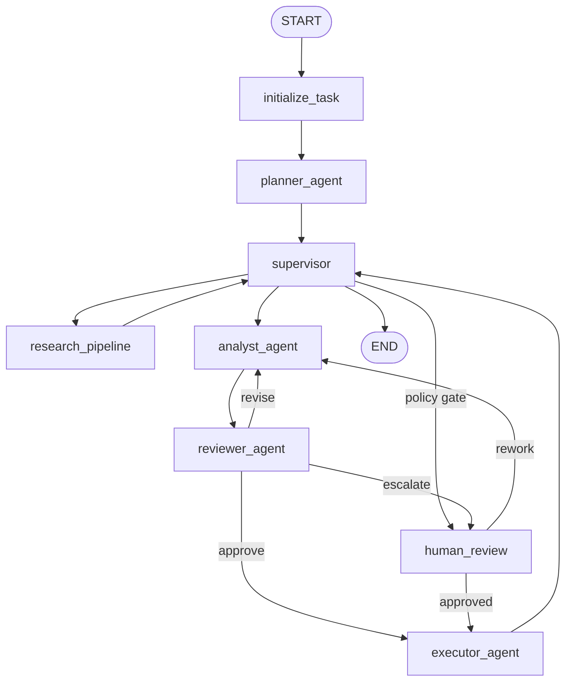
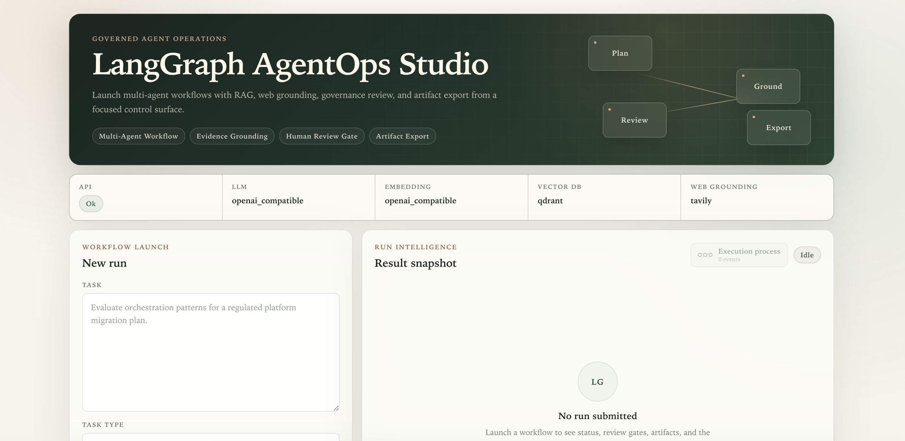
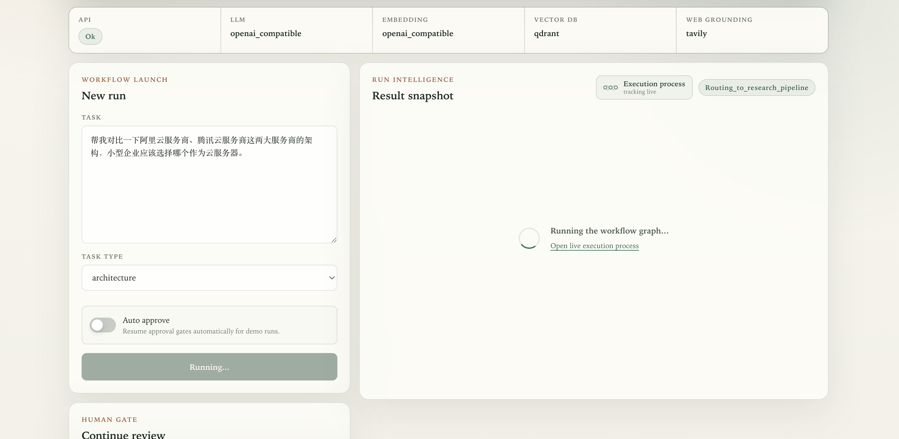
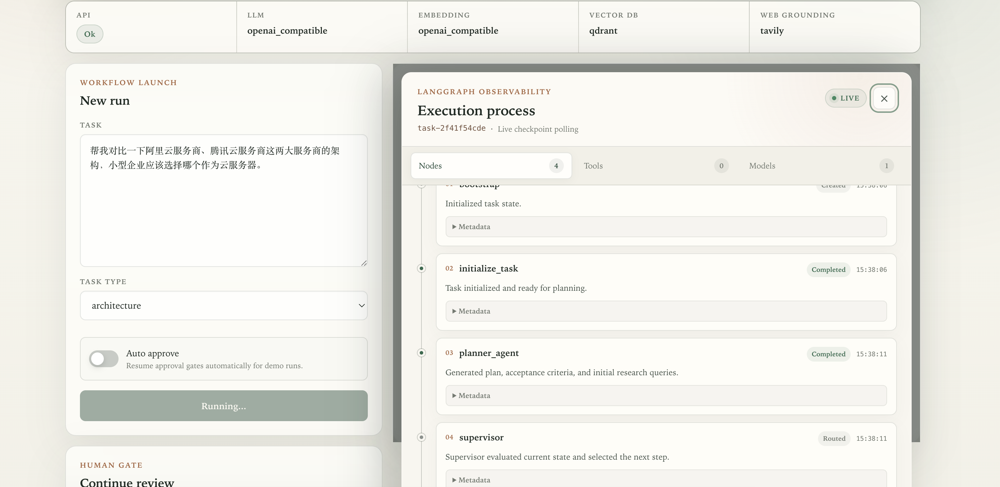
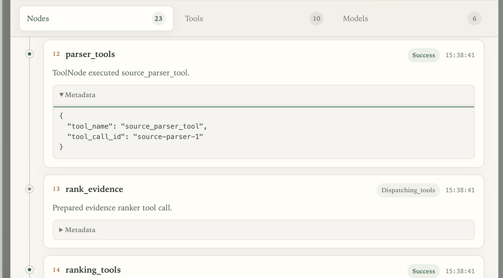
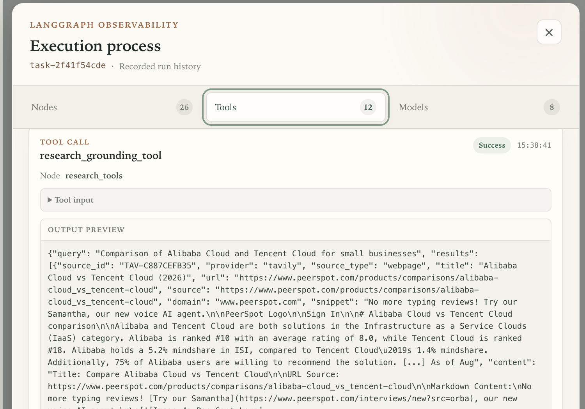
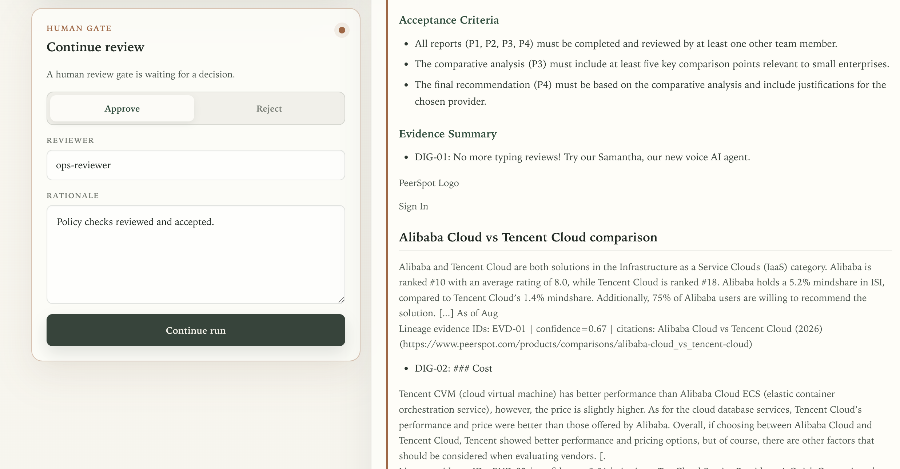

# LangGraph AgentOps Studio

[中文文档](README_zh.md)

LangGraph AgentOps Studio is a LangGraph-native AgentOps workbench for multi-agent research workflows, evidence assessment, recommendation synthesis, policy governance, and auditable artifact export.

## 🧩 Core Capabilities

- Graph-based orchestration with `StateGraph`, `ToolNode`, `Command`, `interrupt`, and checkpoint-backed resume semantics.
- Role-based multi-agent workflow: planner, research pipeline, analyst, reviewer, HITL approval gate, executor, and supervisor.
- Provider-managed LLM and embedding clients (`openai`, `deepseek`, `openai_compatible`).
- Hybrid knowledge retrieval with BM25 and vector recall, RRF fusion, and configurable reranking, complemented by web evidence sources (Tavily + Jina, or Exa search + content extraction).
- RabbitMQ-backed task execution with independent workers, a durable job/outbox registry, bounded admission, and duplicate-delivery protection.
- Provider concurrency limits and circuit breakers, SQLite checkpoints, atomic artifact writes, and operational metrics.
- Evidence assessment pipeline with structured scoring dimensions, support/contradiction analysis, and coverage measurement.
- Evidence-grounded recommendation synthesis with confidence scoring, open questions, and residual risk outputs.
- Policy-based governance evaluation with explicit escalation criteria for human review.
- Checkpoint-backed frontend progress inspection with node traces plus actual tool/model calls and model output previews.
- Auditable artifact set (`final_report.md`, `decision_record.json`, `workflow_trace.json`, `run_artifact.json`, and supporting files).
- Web console for run submission, interrupt review, provider inspection, and artifact path discovery.

## 🔀 Workflow Topology



## 🚀 Quick Start

```bash
python -m venv .venv
source .venv/bin/activate
pip install -e ".[dev]"
cp .env.example .env
```

### Configuration

Start by copying `.env.example` to `.env`. Configure the variables required for the execution mode you intend to use, then enable optional capabilities incrementally.

#### Minimum Configuration

For CLI or API execution, configure one LLM provider:

- `LLM_PROVIDER`: `openai`, `deepseek`, or `openai_compatible`.
- `LLM_MODEL`: the chat completion model used by the workflow.
- `LLM_API_KEY`: the provider API key.
- `LLM_BASE_URL`: required for OpenAI-compatible gateways or custom endpoints; leave empty for the provider default.

Configure one embedding provider as well. The runtime initializes the embedding client even when live web search is disabled:

- `EMBEDDING_PROVIDER`: `openai`, `deepseek`, or `openai_compatible`.
- `EMBEDDING_MODEL`: the text embedding model.
- `EMBEDDING_API_KEY`: the embedding provider API key.
- `EMBEDDING_BASE_URL`: required for OpenAI-compatible gateways or custom endpoints; leave empty for the provider default.

For the web frontend, configure:

- Backend `.env`: `CORS_ORIGINS=http://127.0.0.1:5173,http://localhost:5173`.
- Frontend `web/.env`: `VITE_API_BASE_URL=http://127.0.0.1:8000`.

No remote vector database is required for local development. The default vector store uses embedded Qdrant local storage through `QDRANT_LOCAL_PATH=.qdrant`.

#### Optional Configuration

- Application and runtime controls: `APP_NAME`, `LOG_LEVEL`, `OUTPUT_ROOT`, `CHECKPOINT_MODE`, `MAX_RETRIES`, `MAX_REVISIONS`.
- Task execution: `TASK_QUEUE_MODE` selects `inline` or `rabbitmq`; `MAX_CONCURRENT_RUNS` bounds worker concurrency and `MAX_PENDING_JOBS` bounds the durable backlog. RabbitMQ mode requires `RABBITMQ_URL`, SQLite checkpoints, and server-mode Qdrant when using that vector backend.
- Detailed conclusion controls: `REPORT_DETAIL_LEVEL`, `REPORT_MAX_FINDINGS_IN_CONCLUSION`, `REPORT_MAX_EVIDENCE_IN_CONCLUSION`, `REPORT_MAX_RISKS_IN_CONCLUSION`, and `REPORT_INCLUDE_NEXT_ACTIONS`.
- Vector stores: `VECTOR_DB_PROVIDER` supports Qdrant, Milvus, Weaviate, Chroma, pgvector, Pinecone, and an in-memory test backend. Qdrant remains the default; install another client with its optional extra (for example, `pip install -e ".[milvus]"`). See `docs/providers.md` for backend variables.
- Knowledge retrieval: tune `RAG_SOURCE_DIR`, `RAG_TOP_K`, `RAG_CHUNK_SIZE`, `RAG_CHUNK_OVERLAP`, and the vector-only `RAG_SCORE_THRESHOLD`. Hybrid recall uses `RAG_HYBRID_ENABLED`, `RAG_LEXICAL_PATH`, `RAG_CANDIDATE_K`, and `RAG_RRF_K`.
- Reranking: `RAG_RERANK_PROVIDER=http` uses a model endpoint configured through `RAG_RERANK_URL`, `RAG_RERANK_MODEL`, and optional `RAG_RERANK_API_KEY`. The default `lexical` mode uses local token coverage; `none` preserves RRF order. HTTP reranking failures fall back to RRF.
- Web evidence grounding: set `ENABLE_WEB_SEARCH=true` and provide either `TAVILY_API_KEY` or `EXA_API_KEY` when live web search is required. The default example keeps `ENABLE_WEB_SEARCH=false` so local runs do not depend on external search or reader providers.
- Network proxy: if live web search or page reading is slow, blocked, or times out, configure `HTTP_PROXY` and `HTTPS_PROXY` in the backend `.env`, for example `HTTP_PROXY=http://127.0.0.1:7890`.
- Tavily + Jina mode: configure `WEB_SEARCH_MODE=tavily_jina`, `TAVILY_*`, and optionally `JINA_*` reader settings.
- Exa mode: configure `WEB_SEARCH_MODE=exa`, `EXA_*`, and `EXA_USE_CONTENTS`.
- Governance policy thresholds: tune `GOVERNANCE_*`, `RISK_THRESHOLD_FOR_HUMAN_REVIEW`, and `GOVERNANCE_MANUAL_APPROVAL_POLICY_BY_TASK_TYPE_JSON`.

### Build the Knowledge Index

Ingestion populates the vector store and, when hybrid retrieval is enabled, the persistent BM25 index. Recreating indexes is an offline maintenance operation.

```bash
python app/ingest.py --source-dir examples/knowledge_base --recreate-collection
```

### Deployment (Optional)

Configure provider credentials and `RABBITMQ_PASSWORD` in `.env`, then start the API, workers, RabbitMQ, and Qdrant:

```bash
docker compose up --build -d
docker compose exec api python -m app.ingest --source-dir /knowledge
```

The deployment uses a shared local volume for task metadata, checkpoints, the BM25 index, and artifacts. It supports worker processes on one host; it does not provide multi-host database storage or tenant isolation. The API should be accessed through an authenticated gateway. `/health`, `/ready`, and `/metrics` expose liveness, runtime readiness, and request metrics.

See [operations and deployment](docs/production.md) for capacity settings, delivery semantics, recovery procedures, and deployment boundaries.

### Launch Modes

#### 1. CLI Mode

Run a workflow from an inline task:

```bash
python app/main.py \
  --task "Evaluate orchestration patterns for a regulated platform migration plan." \
  --task-type architecture \
  --auto-approve
```

Run a workflow from a task file:

```bash
python app/main.py \
  --task-file examples/compare_platforms.json \
  --task-type architecture
```

When `--auto-approve` is omitted, high-risk workflows can pause at the HITL approval gate. Resume those runs through the API or the web frontend.

#### 2. API Mode

Start the FastAPI server:

```bash
.venv/bin/uvicorn app.api:app --reload
```

Check service health and active providers:

```bash
curl http://127.0.0.1:8000/health
curl http://127.0.0.1:8000/providers
```

Create a run:

```bash
curl -X POST http://127.0.0.1:8000/runs \
  -H "Content-Type: application/json" \
  -d '{"task":"Evaluate governance controls for a multi-agent platform.","task_type":"architecture","auto_approve":true}'
```

Inspect the latest LangGraph checkpoint while the POST is still running (use a
client-generated `task_id` in the create payload):

```bash
curl http://127.0.0.1:8000/runs/<task_id>
```

The response includes `execution_trace`, `tool_call_history`,
`model_call_history`, `next_nodes`, `draft_report`, and `final_report`. See
[`docs/observability.md`](docs/observability.md) for the exact polling contract.

In RabbitMQ mode, append `?wait=false` to create or continue requests to receive HTTP 202 immediately. Poll the run until `queue_status` is `done` or `failed`, matching `queue_job_id` to the submitted operation. A completed queue operation may leave the workflow awaiting human approval. See [queue request contracts](docs/production.md#request-and-delivery-contracts).

Resume a run after an approval interrupt:

```bash
curl -X POST http://127.0.0.1:8000/runs/<task_id>/continue \
  -H "Content-Type: application/json" \
  -d '{"approved":true,"reviewer":"ops-reviewer","rationale":"Policy checks satisfied."}'
```

Ingest local knowledge-base documents:

```bash
curl -X POST http://127.0.0.1:8000/ingest \
  -H "Content-Type: application/json" \
  -d '{}'
```

The API ingests from `RAG_SOURCE_DIR`; an optional `source_dir` must remain inside that directory. Collection recreation is available only through offline CLI maintenance.

#### 3. Web Frontend Mode

Start the backend:

```bash
.venv/bin/uvicorn app.api:app --reload
```

Start the frontend in another terminal:

```bash
cd web
npm install
cp .env.example .env
npm run dev
```

Open:

```text
http://127.0.0.1:5173
```

The frontend connects to the backend through `VITE_API_BASE_URL` in `web/.env`.

```env
VITE_API_BASE_URL=http://127.0.0.1:8000
```

The frontend polls `GET /runs/{task_id}` for execution progress. In RabbitMQ mode, it tracks the submitted queue operation through completion or failure and displays the human review gate when approval is required.

#### User Input Examples

- **E-commerce support:** Assess the feasibility of multi-agent support for return and refund inquiries. Define human handoff conditions and acceptance criteria.
- **Enterprise knowledge base:** Compare the cost, access isolation, and maintenance effort of a self-hosted RAG system and a managed knowledge base. Recommend an option.
- **Logistics fulfillment:** Use existing operations documents to assess order delay risks during a major sales campaign. Propose monitoring metrics and contingency measures.
- **Vendor procurement:** Compare three cloud providers on SLA, cost, and data residency requirements. Identify information to verify and recommend a procurement option.

## 📦 Run Outputs

Completed workflow artifacts are persisted under:

```text
runs/<task_id>/
```

The artifact root is controlled by `OUTPUT_ROOT=runs` in `.env`. For example, a run with task ID `demo-run` writes files to:

```text
runs/demo-run/
```

Final output files include:

- `final_report.md`: reviewer-facing recommendation report.
- `decision_record.json`: compact decision record for downstream governance review.
- `workflow_trace.json`: chronological workflow execution trace.
- `run_artifact.json`: structured artifact manifest with selected state and decision data.
- `state_snapshot.json`: serialized workflow state snapshot for audit and replay.
- `context_compaction.json`: context compaction statistics, active evidence digests, and review delta state.
- `context_manifest.json`: rehydration pointers for raw tool outputs and archived trace segments.

If a run pauses at the HITL approval gate, final artifacts are not complete until the run is resumed and reaches the executor. The API and web frontend also return `artifact_paths` after artifacts are exported.

## 🗜️ Context Compaction

The workflow keeps protected task context unchanged while reducing the active context passed between later stages. User request, task type, plan, acceptance criteria, active search queries, governance constraints, and human approval state are protected from lossy compaction.

The strategy is type-aware:

- System and task constraints are strongly protected and validated after compaction.
- Recent user intent is retained verbatim instead of being rewritten into a summary.
- Raw tool outputs are lifecycle-managed: parsed, materialized, persisted, then offloaded from active context.
- Retrieved evidence is semantically deduplicated and distilled into structured evidence digests.
- Reviewer history is compressed into a revision delta with resolved, open, and new issues.
- Execution trace is archived as an external artifact and rehydrated for final export.
- Old conversation is summarized only under context pressure while preserving protected fields.

Research completion is a phase boundary. After tool outputs have been parsed into structured state, large raw tool messages can be written under `runs/<task_id>/context/raw_tool_outputs/` and replaced in active message context with artifact pointers. Ranked evidence remains in the audit ledger, while analyst and reviewer prompts can use structured evidence digests with source, citation, conflict, support, and lineage metadata.

Reviewer iterations maintain a revision ledger with resolved, open, and new issues so the next analyst pass does not repeatedly consume the full reviewer history. Long execution traces can be archived under `runs/<task_id>/context/execution_trace_archive.json`; final `workflow_trace.json` rehydrates the archive and active tail before export.

Compaction is fail-open. If embedding, summarization, artifact writing, or rehydration fails, the workflow continues with the original context. See `docs/context_compaction.md` for the full strategy and configuration.

## 🖥️ Interface Overview

<p align="center">
  
  <br />
  <em>Landing dashboard with the workflow launcher and provider status strip.</em>
</p>

<p align="center">
  
  <br />
  <em>Live run state with routing progress and the execution-process entry point.</em>
</p>

<p align="center">
  
  <br />
  <em>Live LangGraph observability panel with checkpoint polling and node counts.</em>
</p>

<p align="center">
  
  <br />
  <em>Node timeline with ToolNode events, statuses, timestamps, and expandable metadata.</em>
</p>

<p align="center">
  
  <br />
  <em>Tools view showing a research-grounding call and its output preview.</em>
</p>

<p align="center">
  
  <br />
  <em>Human review gate alongside a detailed evidence-grounded report.</em>
</p>

## 🌐 Web Frontend

The `web/` application provides a paper-and-forest AgentOps control plane with:

- task submission with task-type classification (`general`, `architecture`, `security`, `finance`);
- an auto-approval switch for demonstration runs;
- backend health checks and provider status inspection;
- run result snapshots with task ID, lifecycle status, provider details, review summary, decision context, artifact paths, and raw JSON;
- checkpoint-backed execution process inspection for node events, tool calls, model calls, model outputs, and next scheduled nodes;
- a human review panel for approving or rejecting interrupted runs.

## 🗂️ Web Directory Structure

```text
web/
  package.json
  index.html
  vite.config.ts
  tsconfig.json
  .env.example
  README.md
  src/
    main.tsx
    App.tsx
    api/
      client.ts
    components/
      ...
    styles/
      ...
```

## 🧪 Testing

Deterministic unit tests:

```bash
python -m pytest -q -p no:cacheprovider
```

Integration smoke tests (network access + provider credentials):

```bash
RUN_REAL_WEB_GROUNDING=1 pytest tests/integration/test_real_web_grounding.py
RUN_REAL_PROVIDER_RUN=1 pytest tests/integration/test_real_provider_run.py
# Set RABBITMQ_TEST_URL to an isolated test broker before running:
pytest tests/integration/test_rabbitmq_delivery.py
```

Integration tests are env-gated and skip when required keys are not present.

Backend bytecode compilation check:

```bash
python -m compileall app agents graph services tools schemas config artifacts
```

Frontend production build:

```bash
cd web
npm install
npm run build
```

## 🔧 Troubleshooting

- Frontend cannot connect to the API: verify `VITE_API_BASE_URL` in `web/.env` and `CORS_ORIGINS` in the backend environment. The default backend CORS origins include `http://127.0.0.1:5173` and `http://localhost:5173`.
- Run creation fails: verify LLM, embedding, and web search API keys in `.env`.
- Live web search is slow or frequently fails: set `HTTP_PROXY` and `HTTPS_PROXY` in the backend `.env`, then restart the API server.
- No Tavily or Exa key is available: set `ENABLE_WEB_SEARCH=false` to run without live web search.
- A high-risk task triggers human approval: enable `--auto-approve`, set `auto_approve=true`, or resume through `/runs/{task_id}/continue` or the web frontend review panel.

## 📚 Documentation

- [Operations and deployment](docs/production.md)
- `docs/architecture.md`
- `docs/providers.md`
- `docs/rag.md`
- `docs/web_search.md`
- `docs/evidence.md`
- `docs/governance.md`
- `docs/context_compaction.md`
- `docs/testing.md`

## 📄 License

MIT (`LICENSE`).
